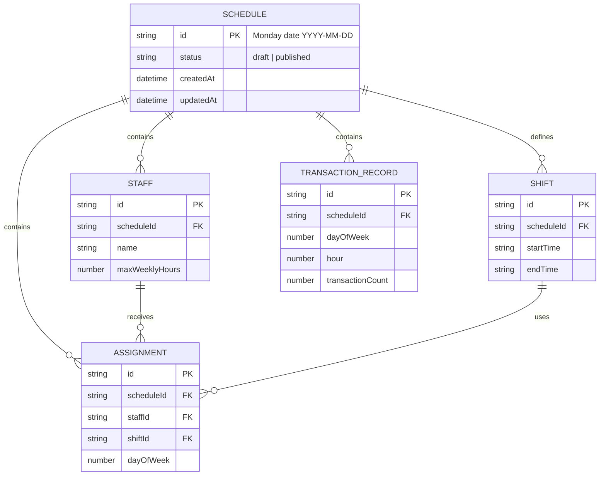

# Staff Scheduling Application — ERD

## 1. Overview

The application manages weekly staff schedules for retail and food-service businesses.

A schedule represents one typical Monday–Sunday week. Its ID is the Monday date of that week, formatted as `YYYY-MM-DD`.

Each schedule owns its employees, shift templates, assignments, and transaction records. Data is isolated between schedules.

## 2. Entity Relationship Diagram

## 3. Entity Definitions

### 3.1 Schedule

Represents one typical Monday–Sunday scheduling week.

| Field | Type | Description |
|---|---|---|
| `id` | string (PK) | Monday's date in `YYYY-MM-DD` format |
| `status` | `draft` \| `published` | New schedules are `draft`; publishing sets `published` |
| `createdAt` | datetime | Creation timestamp |
| `updatedAt` | datetime | Last update timestamp |

**Rules:**
- The schedule ID must always represent a Monday.
- Each Monday date can identify only one schedule.
- A schedule owns its staff, shift templates, assignments, and transaction records.
- Data belonging to one schedule must not be shared with another schedule.
- The first change to a published schedule (assignments, staff, or adding/editing/deleting a shift template) returns it to `draft` and keeps the last published content, including shift templates, until the draft is published or discarded.
- A schedule can be published only when no employee has overlapping assignments. Editing a shift template can create overlaps in a draft; they are highlighted in the roster and must be resolved before publishing. Employees over their maximum weekly hours (possible only after editing a shift template or an employee's maximum) are highlighted and also block publishing.

### 3.2 Staff

Represents an employee belonging to a specific schedule.

| Field | Type | Description |
|---|---|---|
| `id` | string (PK) | Unique employee identifier |
| `scheduleId` | string (FK) | Schedule that owns this employee |
| `name` | string | Employee's name |
| `maxWeeklyHours` | number | Maximum working hours per week |

**Rules:**
- A staff member belongs to exactly one schedule.
- A staff member can have multiple assignments within that schedule.
- Weekly working hours are calculated from assignments within the schedule.
- Maximum weekly hours are a hard limit for new assignments; edits that push an employee over are highlighted in the draft and block publishing.

### 3.3 Shift

Represents a reusable shift template within a schedule.

| Field | Type | Description |
|---|---|---|
| `id` | string (PK) | Unique shift identifier |
| `scheduleId` | string (FK) | Schedule that owns this shift |
| `startTime` | string | Start time in `HH:mm` format |
| `endTime` | string | End time in `HH:mm` format |

**Rules:**
- A shift is defined only by its start and end times.
- Default shifts:
  - 07:00–15:00
  - 15:00–23:00
- Multiple employees can be assigned to the same shift on the same day.
- Different shift templates may overlap.
- Overnight shifts are not supported initially.

### 3.4 Assignment

Connects a staff member to a shift on a specific day within a schedule.

| Field | Type | Description |
|---|---|---|
| `id` | string (PK) | Unique assignment identifier |
| `scheduleId` | string (FK) | Schedule containing the assignment |
| `staffId` | string (FK) | Assigned employee |
| `shiftId` | string (FK) | Assigned shift template |
| `dayOfWeek` | number | Day of the week: Monday = 0, Sunday = 6 |

**Rules:**
- An assignment must reference an existing staff member and shift.
- Both the staff member and shift must belong to the assignment's schedule.
- A staff member cannot have overlapping assignments on the same day.
- A staff member can have multiple non-overlapping assignments on the same day.
- An assignment that would take an employee above `maxWeeklyHours` is blocked.

### 3.5 TransactionRecord

Stores hourly transaction counts for a schedule.

| Field | Type | Description |
|---|---|---|
| `id` | string (PK) | Unique record identifier |
| `scheduleId` | string (FK) | Schedule containing the data |
| `dayOfWeek` | number | Day of the week: Monday = 0, Sunday = 6 |
| `hour` | number | Hour of the day: 0–23 |
| `transactionCount` | number | Number of transactions during that hour |

**Rules:**
- Each record represents one hour on one day.
- There should be at most one record per `(scheduleId, dayOfWeek, hour)`.
- Transaction counts must be non-negative integers.
- Importing a new CSV replaces the existing transaction dataset for that schedule.

## 4. Relationships

| Relationship | Cardinality | Description |
|---|---|---|
| Schedule → Staff | 1:N | A schedule owns multiple employees |
| Schedule → Shift | 1:N | A schedule defines reusable shift templates |
| Schedule → Assignment | 1:N | A schedule contains multiple assignments |
| Schedule → TransactionRecord | 1:N | A schedule contains hourly transaction data |
| Staff → Assignment | 1:N | An employee can have multiple assignments |
| Shift → Assignment | 1:N | A shift template can be used by multiple assignments |

## 5. Business Constraints

### Schedule
- Schedule IDs must be valid Monday dates in `YYYY-MM-DD` format.
- There can be only one schedule per Monday date.
- All schedule-owned entities must reference an existing schedule.

### Staff
- Each staff member belongs to exactly one schedule.
- Employee IDs must be unique.
- Deleting an employee must also remove or explicitly handle their assignments.

### Assignment
- The referenced staff member and shift must belong to the same schedule as the assignment.
- The same employee cannot have overlapping assignments within a schedule.
- Weekly hours must be calculated per employee, per schedule.
- Maximum weekly hours are a hard limit; an over-maximum draft cannot be published.

### Shift
- Start time must be earlier than end time.
- Shift duration is calculated from the difference between start and end times.
- Shift templates can overlap with other templates.

### TransactionRecord
- There must be no duplicate hourly records within a schedule.
- Transaction counts cannot be negative.

## 6. Derived Data

The following values should be calculated from the underlying entities rather than stored separately.

| Derived value | Calculation |
|---|---|
| Shift duration | `endTime - startTime` |
| Employee weekly hours | Sum of assigned shift durations within a schedule |
| Hourly staff coverage | Number of employees assigned during that hour |
| Transactions per staff hour | `transactionCount / staffCoverage` |
| Total weekly staff hours | Sum of hourly staff coverage across the week |
| Total weekly transactions | Sum of transaction counts |
| Overall weekly ratio | `totalTransactions / totalStaffHours` |
| Average hourly ratio | Mean of hourly ratios for hours with staff coverage |

When hourly staff coverage is zero, the hourly ratio should display `–`.

## 7. Initial Assumptions

- A schedule represents a typical week, identified by its Monday date.
- Staff members belong to a single schedule and are not shared across schedules.
- Each schedule has one active transaction dataset.
- Shift templates are reusable across days within their schedule.
- Shift times use 24-hour `HH:mm` format.
- Overnight shifts are out of scope for the initial implementation.
