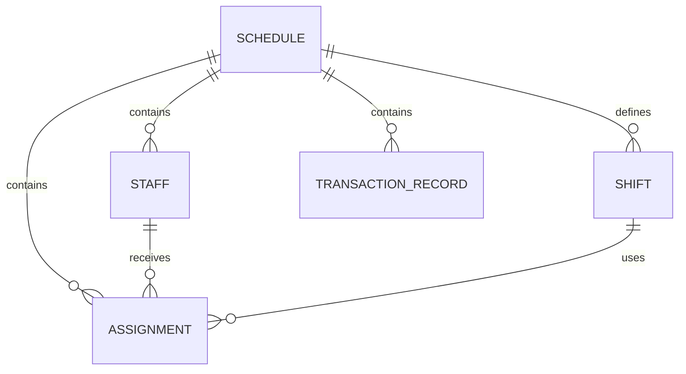

# Product Requirements Document — Employee Scheduler

|                       |                                                                                                                                                                                                     |
| --------------------- | --------------------------------------------------------------------------------------------------------------------------------------------------------------------------------------------------- |
| **Product**           | Employee Scheduler, a weekly staff scheduling web app for retail and food-service managers                                                                                                          |
| **Status**            | Phases 1–9 built; manual browser verification and final polish still open (section 13)                                                                                                              |
| **Document scope**    | Describes the product **as built**. Items not built are listed as out of scope or future work, never as commitments.                                                                                |
| **Related documents** | [`ERD.md`](ERD.md) (data model), [`algorithm.md`](algorithm.md) (auto-scheduler design), [`ROADMAP.md`](ROADMAP.md) (phases and decisions), [`README.md`](README.md) (setup, assumptions, research) |

---

## 1. Overview

### 1.1 Summary

Employee Scheduler lets a store manager build a Monday–Sunday roster, load the week's hourly transaction numbers, see at a glance where the store is understaffed, and generate a first draft automatically. The manager then adjusts the draft by hand and publishes it. The app enforces the rules a manager cares about: nobody works two overlapping shifts, and nobody goes over their maximum weekly hours.

### 1.2 Problem

Managers build weekly rosters by hand, usually in a spreadsheet. That is slow, and it is hard to tell whether busy hours are covered, whether someone has been scheduled twice at once, or whether someone has been pushed past their hours. Established workforce tools solve this but are built for chains: they need sales-system integrations, forecasts and subscriptions, which is more than a single store needs.

### 1.3 Goals

1. A manager can go from an empty week to a publishable roster quickly: upload transactions, press **Auto-schedule**, adjust, **Publish**.
2. A published schedule never contains overlapping shifts or employees over their maximum hours.
3. The manager can always see, on the roster itself, how many hours each employee has, where shifts overlap, and which hours are understaffed.
4. The app is trustworthy with data: it survives a refresh, and it never silently loses saved schedules.
5. All wording and behaviour make sense to a non-technical manager.

### 1.4 Success measures

These are targets for judging the product, not instrumented metrics (the app has no analytics).

| Measure                                                                       | Target                                 |
| ----------------------------------------------------------------------------- | -------------------------------------- |
| Time from a new week with employees and shifts to a publishable roster        | Under 2 minutes, using Auto-schedule   |
| Published schedules containing an overlap or an over-limit employee           | None (blocked by the product)          |
| Auto-schedule run time on a typical team (up to about 15 employees, 6 shifts) | Under 1 second, with a 5 second budget |
| Saved schedules lost after refresh                                            | None                                   |

---

## 2. Users and scenarios

### 2.1 Primary user

A **store or restaurant manager** (single user, one location). Not technical, works on a laptop or desktop browser, schedules one week at a time, and knows their team's weekly hour limits and the store's busy periods. Terms they use: employee, shift, schedule, hours, understaffed, publish.

### 2.2 Key jobs

1. Build next week's roster.
2. Add cover for a busy day.
3. Replace someone who can't work.
4. Check that nobody is over their hours or double-booked.
5. Publish the roster, and change it later without losing the published version until the change is published.

### 2.3 Scenarios

**A. Plan next week from scratch.** The manager opens next week and sees "No schedule for this week". They choose **New schedule**, confirm the shifts, enter employees and their maximum weekly hours, and optionally upload the week's hourly transactions. The roster opens as a draft. They press **Auto-schedule**; the roster fills in and the summary shows any understaffed hours. They adjust a few cells and press **Publish**.

**B. Repeat last week.** The manager opens a new week and chooses **Copy previous schedule**. Employees, shifts, assignments, transactions and the transactions-per-employee value are copied as an independent draft.

**C. Someone calls in sick on a published week.** The manager removes that employee's shift. The schedule returns to draft, the removed shift stays visible struck through (so it can be undone), and the last published version is kept. The manager adds the shift to another employee. If that would put them over their hours, the app refuses and says why. When the roster is right, **Publish** replaces the published version; **Discard changes** would restore it.

---

## 3. Scope

### 3.1 In scope

Weekly schedules; employees with weekly hour limits; reusable shifts; manual roster editing with rule enforcement; draft/publish workflow; hourly transaction upload and review; coverage and weekly summary; automatic draft generation; browser persistence.

### 3.2 Out of scope (not built)

- Accounts, login, multiple users, multiple stores, a server or database. All data stays in the browser.
- Employee availability, time off, skills, breaks, preferred days, minimum staffing rules.
- Pay rates and labor cost; overtime pay. (Overtime is prevented, not priced.)
- Shift swaps, call-out workflows, notifications, mobile app.
- Overnight shifts (a shift's end must be after its start on the same day).
- Forecasting demand from history. The manager supplies the week's actual hourly transactions.
- Opening hours: an hour with no transactions is treated as needing no staff.

---

## 4. Concepts and glossary

| Term                                         | Meaning                                                                                                                                                                                               |
| -------------------------------------------- | ----------------------------------------------------------------------------------------------------------------------------------------------------------------------------------------------------- |
| **Schedule**                                 | One Monday–Sunday week. Its ID is the Monday's date (`YYYY-MM-DD`). Only one schedule per Monday.                                                                                                     |
| **Employee**                                 | A person on one schedule, with a name and a maximum weekly hours. Employees belong to a single schedule.                                                                                              |
| **Shift**                                    | A reusable start–end time (24-hour `HH:mm`) defined per schedule, such as 07:00–15:00. Shifts may overlap each other.                                                                                 |
| **Assignment** (shown as "a shift on a day") | An employee working a shift on a day.                                                                                                                                                                 |
| **Transactions**                             | The number of customer transactions in each hour of each day, from an uploaded report.                                                                                                                |
| **Draft / Published**                        | New schedules are drafts. Publishing marks the schedule published. The first change to a published schedule makes it a draft again and keeps the last published version until published or discarded. |
| **Hour limit**                               | An employee's maximum weekly hours. A hard limit.                                                                                                                                                     |
| **Staffed hour**                             | Any clock hour that a shift touches; an employee counts once per hour. A 07:30–15:30 shift touches hours 7 through 15.                                                                                |
| **Understaffed**                             | An hour where the number of employees working is below the number required.                                                                                                                           |
| **Transactions per employee per hour (N)**   | How many transactions one employee can handle in an hour. Default 15, whole number 1–1000, saved per week.                                                                                            |

### 4.1 Derived values (calculated, never stored)

| Value                              | Calculation                                                                                                                                                                                                       |
| ---------------------------------- | ----------------------------------------------------------------------------------------------------------------------------------------------------------------------------------------------------------------- |
| Shift duration                     | End time minus start time                                                                                                                                                                                         |
| Employee weekly hours              | Sum of the durations of their shifts that week                                                                                                                                                                    |
| Hourly staffed count               | Distinct employees working any part of that hour                                                                                                                                                                  |
| Required staff for an hour         | `0` if no transactions, otherwise `max(1, ceil(transactions ÷ N))`                                                                                                                                                |
| Shortfall for an hour              | `max(0, required − staffed)`                                                                                                                                                                                      |
| Per hour worked ("Txn / staff hr") | Hour transactions ÷ staffed count; shown as `–` when nobody is working                                                                                                                                            |
| Week figures                       | Total transactions; hours worked (sum of hourly staffed counts); total transactions ÷ hours worked; "typical hour" (mean of the hourly ratios over hours that have staff); understaffed hours (sum of shortfalls) |

Worked example with N = 15:

| Transactions in the hour | 0   | 5   | 15  | 16  | 30  | 45  | 60  |
| ------------------------ | --- | --- | --- | --- | --- | --- | --- |
| Employees required       | 0   | 1   | 1   | 2   | 2   | 3   | 4   |

---

## 5. Business rules

These apply everywhere, whether the change comes from the manager or from Auto-schedule.

| #     | Rule                                                                                                                                                 |
| ----- | ---------------------------------------------------------------------------------------------------------------------------------------------------- |
| BR-1  | A schedule is one Monday–Sunday week and owns its employees, shifts, assignments and transactions. Nothing is shared between weeks.                  |
| BR-2  | An employee cannot have overlapping shifts on the same day. Touching times (one ends at 15:00, the next starts at 15:00) do not overlap.             |
| BR-3  | An employee cannot be given the same shift twice on one day.                                                                                         |
| BR-4  | **Maximum weekly hours are a hard limit.** A new assignment that would take an employee over it is refused. Exactly reaching the maximum is allowed. |
| BR-5  | Editing a shift's times, or lowering an employee's maximum, may leave a draft with overlaps or an employee over the limit. These are highlighted.    |
| BR-6  | **Publish gate.** A schedule with any overlap or any employee over their limit cannot be published.                                                  |
| BR-7  | Different shifts may overlap; several employees may work the same shift.                                                                             |
| BR-8  | Importing transactions replaces the week's existing transaction data.                                                                                |
| BR-9  | Deleting an employee or a shift also removes their assignments, after a confirmation that says how many.                                             |
| BR-10 | Overnight shifts are rejected: end time must be after start time.                                                                                    |

---

## 6. Functional requirements

Each requirement lists acceptance criteria that can be checked in the app. Where a unit test already covers the logic, the test file is named.

### FR-1 Weeks and schedules

| ID     | Requirement     | Acceptance criteria                                                                                                                                                                                                                                                                                                                |
| ------ | --------------- | ---------------------------------------------------------------------------------------------------------------------------------------------------------------------------------------------------------------------------------------------------------------------------------------------------------------------------------- |
| FR-1.1 | Week navigation | Previous / Next week buttons and a **This week** button move between weeks. This week is disabled when already shown. The title shows the range (for example "Nov 16 – Nov 22, 2026").                                                                                                                                             |
| FR-1.2 | Jump to a week  | Clicking the title lists 8 weeks either side of the shown week plus every existing schedule. Each existing schedule shows its status; the current week is tagged. (`date.test.ts`)                                                                                                                                                 |
| FR-1.3 | Empty week      | A week with no schedule shows "No schedule for this week" with **New schedule**, and **Copy previous schedule** only when an earlier schedule exists.                                                                                                                                                                              |
| FR-1.4 | New schedule    | A 3-step dialog: **Shifts**, **Employees** (at least one required), **Transactions** (optional). It is pre-filled from the latest earlier schedule (shift times, employee names and limits, transactions); the first schedule starts with the two default shifts. Nothing is saved until **Create schedule**. (`schedule.test.ts`) |
| FR-1.5 | Copy previous   | Creates a draft that is a full, independent copy of the latest earlier schedule: shifts, employees, assignments, transactions, and its transactions-per-employee value. Editing the copy never changes the original. (`schedule.test.ts`)                                                                                          |
| FR-1.6 | Delete schedule | **Delete schedule** (header, left of Auto-schedule) asks for confirmation naming the week, then removes the schedule and everything it owns. The manager stays on that week, which shows the empty state. It is disabled while Auto-schedule runs. (`schedule.test.ts`, `schedule-store.test.ts`, `persist.test.ts`)               |

### FR-2 Employees

| ID     | Requirement     | Acceptance criteria                                                                                                                                                            |
| ------ | --------------- | ------------------------------------------------------------------------------------------------------------------------------------------------------------------------------ |
| FR-2.1 | Add employees   | **Add employees** accepts several rows at once (name, max hours per week).                                                                                                     |
| FR-2.2 | Validation      | Name is required and at most 60 characters. Maximum hours must be more than 0 and at most 168. Errors appear next to the field in plain language. (`staff.test.ts`)            |
| FR-2.3 | Edit employee   | Name and maximum can be edited. Lowering the maximum below current hours is allowed in a draft; the employee is highlighted and the schedule cannot be published (BR-5, BR-6). |
| FR-2.4 | Delete employee | A confirmation says how many of their shifts will be removed.                                                                                                                  |
| FR-2.5 | Hours display   | Each employee row shows `assigned h / max h`, amber with a warning icon when over.                                                                                             |

### FR-3 Shifts

| ID     | Requirement       | Acceptance criteria                                                                                                                              |
| ------ | ----------------- | ------------------------------------------------------------------------------------------------------------------------------------------------ |
| FR-3.1 | Default shifts    | A new first schedule has 07:00–15:00 and 15:00–23:00.                                                                                            |
| FR-3.2 | Manage shifts     | The **Shifts** dialog lists shifts sorted by time and supports add, edit and delete.                                                             |
| FR-3.3 | Validation        | Both times are required; end must be after start (overnight is rejected with a clear message); an identical shift is rejected. (`shift.test.ts`) |
| FR-3.4 | Edit consequences | Editing a shift that is in use is allowed. Any overlaps or over-limit hours it creates are highlighted and block publishing (BR-5).              |
| FR-3.5 | Delete shift      | A confirmation says how many employees will be removed from it.                                                                                  |

### FR-4 Roster editing

| ID     | Requirement              | Acceptance criteria                                                                                                                                                                                                                                                                  |
| ------ | ------------------------ | ------------------------------------------------------------------------------------------------------------------------------------------------------------------------------------------------------------------------------------------------------------------------------------ |
| FR-4.1 | Grid                     | Employees are rows and Monday–Sunday are columns. Each cell shows that employee's shifts that day as colored badges, with a **+** to add another. A footer shows total hours scheduled per day and for the week.                                                                     |
| FR-4.2 | Add a shift              | Choosing a shift from **+** adds it. The menu lists each shift's duration, or the reason it cannot be chosen.                                                                                                                                                                        |
| FR-4.3 | Blocked additions        | The app refuses and explains: overlaps another shift ("Overlaps the 07:00–15:00 shift"), already on this shift, or "Ann would reach 42h (limit 40h)". State does not change when refused. (`assignment.test.ts`)                                                                     |
| FR-4.4 | Remove a shift           | Hovering a badge shows an **x** that removes it.                                                                                                                                                                                                                                     |
| FR-4.5 | Pending removals         | On a published week, a removed shift stays visible, struck through and faded, with an **Undo** button until the change is published. Undo is allowed even if it recreates an overlap (it is then highlighted and blocks publishing). It is disabled if the shift itself was deleted. |
| FR-4.6 | Highlights               | A cell with overlapping shifts has a red background. An over-limit employee shows an amber hours label. A legend at the top right explains: over hour limit, overlapping shifts, understaffed.                                                                                       |
| FR-4.7 | Not-yet-published marker | Assignments added since the last publish are shown in a neutral style, with the tooltip "Not published yet".                                                                                                                                                                         |

### FR-5 Draft and publish

| ID     | Requirement              | Acceptance criteria                                                                                                                             |
| ------ | ------------------------ | ----------------------------------------------------------------------------------------------------------------------------------------------- |
| FR-5.1 | Status                   | New schedules are drafts. **Publish** marks the schedule published and then reads "Published" (disabled).                                       |
| FR-5.2 | Editing a published week | The first change returns it to draft and keeps the last published version (including its shifts). (`schedule-store.test.ts`, `draft.test.ts`)   |
| FR-5.3 | Changes detection        | If every change is undone so the draft equals the published version, Publish stays disabled and **Discard changes** disappears.                 |
| FR-5.4 | Publish gate             | Publish is disabled while any overlap or over-limit employee exists (BR-6). The red cells and amber hours show where to look. (`draft.test.ts`) |
| FR-5.5 | Discard                  | **Discard changes** asks for confirmation ("Your unpublished changes will be lost…") and restores the last published version.                   |

### FR-6 Transactions

| ID     | Requirement                        | Acceptance criteria                                                                                                                                                                                                                                                                              |
| ------ | ---------------------------------- | ------------------------------------------------------------------------------------------------------------------------------------------------------------------------------------------------------------------------------------------------------------------------------------------------ |
| FR-6.1 | Template                           | **Download CSV template** gives a file in the sample layout: a title row with the week's date range, dated weekday headers, and hour rows.                                                                                                                                                       |
| FR-6.2 | Upload                             | **Upload CSV** reads a `.csv` of up to 1 MB. Columns are matched by weekday name (Monday–Sunday in any order), not by date. Hours may be written like `7am` or `13:00`. (`parse-csv.test.ts`, `transactions.test.ts`)                                                                            |
| FR-6.3 | Errors                             | Problems are shown in plain language, for example "Choose a CSV file (.csv).", "That file is too big (1 MB max).", "Couldn't find the row with the days (Monday–Sunday).", "Add the missing days: Thursday.", "The file has no hourly rows. Add a row for each hour." Nothing is saved on error. |
| FR-6.4 | Review before saving               | After upload, an hour × weekday table shows the numbers. **Save** applies them and replaces any existing data (BR-8); **Cancel** discards, with a confirmation if there are unsaved changes.                                                                                                     |
| FR-6.5 | Export                             | **Export transactions** downloads the saved table as CSV named with the week's dates.                                                                                                                                                                                                            |
| FR-6.6 | Transactions per employee per hour | A field above the table sets N (whole number 1–1000, default 15). It is validated inline; Save is disabled while invalid; changing only N enables Save. N is stored per week and used by the coverage figures and Auto-schedule. (`demand.test.ts`)                                              |
| FR-6.7 | Storage                            | Transaction data is stored per schedule and does not turn a published schedule into a draft.                                                                                                                                                                                                     |

### FR-7 Coverage and summary

| ID     | Requirement          | Acceptance criteria                                                                                                                                                                                                                       |
| ------ | -------------------- | ----------------------------------------------------------------------------------------------------------------------------------------------------------------------------------------------------------------------------------------- |
| FR-7.1 | Weekly summary strip | When the week has transactions, a strip above the roster shows: Transactions, Hours worked, Txn / staff hr, Typical hour, Understaffed hours. Each has a plain-language tooltip. It updates after every roster edit. (`coverage.test.ts`) |
| FR-7.2 | Day header           | Each weekday header shows a "-Nh" pill when that day has understaffed hours.                                                                                                                                                              |
| FR-7.3 | Day coverage view    | Clicking a weekday opens an hour-by-hour table for that day: transactions, employees working, ratio, with day totals. Zero staff shows `–`. Hours with transactions but nobody working are marked "No staff".                             |
| FR-7.4 | No demand data       | Without transactions the summary and coverage show nothing and the roster still works.                                                                                                                                                    |

### FR-8 Auto-schedule

| ID     | Requirement       | Acceptance criteria                                                                                                                                                                                                                                                                          |
| ------ | ----------------- | -------------------------------------------------------------------------------------------------------------------------------------------------------------------------------------------------------------------------------------------------------------------------------------------- |
| FR-8.1 | One click         | **Auto-schedule** runs immediately for the shown week using that week's saved transactions-per-employee value. There is no dialog and no confirmation.                                                                                                                                       |
| FR-8.2 | Availability      | The button is disabled, with a tooltip, until the week has transactions, at least one employee and at least one shift ("Upload your transactions first", "Add employees first", "Add shifts first").                                                                                         |
| FR-8.3 | Result is a draft | The week's assignments are replaced with the generated ones (including manual ones). A published week becomes a draft and its published version is kept. Nothing is published automatically.                                                                                                 |
| FR-8.4 | Rules respected   | The result never contains overlaps or an employee over their maximum hours, so it is always publishable. (`auto-schedule.test.ts`)                                                                                                                                                           |
| FR-8.5 | Priorities        | In strict order: fewest understaffed hours; then no needless hours; then fairness, measured as each person's hours as a share of their own maximum.                                                                                                                                          |
| FR-8.6 | No undo for a run | There is no button to undo an Auto-schedule run: the replaced assignments are not recoverable from the screen. On a published week, **Discard changes** restores the published version. (The store keeps the replaced assignments for a future Undo; no screen uses it yet. See section 13.) |
| FR-8.7 | In progress       | While running, the roster is covered by a lightly blurred overlay reading "Auto scheduling…", which also blocks clicks. Delete schedule is disabled.                                                                                                                                         |
| FR-8.8 | Errors            | If it fails, an alert says so and that the roster was not changed, with **Retry**.                                                                                                                                                                                                           |
| FR-8.9 | Repeatable        | The same input gives the same roster.                                                                                                                                                                                                                                                        |

### FR-9 Persistence and reliability

| ID     | Requirement        | Acceptance criteria                                                                                                                                                          |
| ------ | ------------------ | ---------------------------------------------------------------------------------------------------------------------------------------------------------------------------- |
| FR-9.1 | Save automatically | Changes are saved to the browser's IndexedDB shortly after they happen (about 0.3 s) and when the tab is hidden. Nothing is written before saved data has loaded.            |
| FR-9.2 | Restore            | After a refresh, all schedules, drafts (including the kept published version), transactions and per-week N come back. The app opens on the current week. (`persist.test.ts`) |
| FR-9.3 | Loading state      | "Loading schedules…" is shown until saved data is read, to avoid flashing the empty state.                                                                                   |
| FR-9.4 | Damaged data       | Saved data that fails validation is set aside under a separate key, the app starts empty, and an alert explains this. (`persistence.test.ts`)                                |
| FR-9.5 | Storage problems   | If storage can't be opened or a save fails, a dismissible alert says so ("Changes aren't being saved"). The rest of the app keeps working.                                   |
| FR-9.6 | Not saved          | The shown week and the store's replaced-assignments copy are session-only.                                                                                                   |

---

## 7. Auto-scheduler requirements

The scheduler models the week as a constraint problem and solves it with Google OR-Tools CP-SAT in the browser (WebAssembly, in a web worker). The detailed design is in [`algorithm.md`](algorithm.md).

**Inputs.** Employees (with maximum hours), shifts, hourly transactions, and N.

**Outputs.** A list of assignments, plus understaffed hours and hours per employee, computed from the final roster so they match what the Coverage view shows. Existing assignments are ignored: the roster is built from scratch.

**Behaviour.**

1. Convert hourly transactions to required employees using the formula in section 4.1.
2. Choose, for every employee, day and shift, whether they work it.
3. Hard rules: no overlapping shifts for one employee; no employee over their maximum weekly hours; an employee with a maximum of 0 is never scheduled.
4. Goals in strict priority: (1) minimize understaffed hours, (2) minimize total scheduled hours so fairness doesn't add work nobody needs, (3) minimize the gap between the most and least utilized employee (utilization = hours ÷ that employee's own maximum).
5. When there aren't enough available hours, the shortfall is reported as understaffed hours. It is never filled with overtime.

**Assumptions.**

- N defaults to 15 transactions per employee per hour (one every four minutes), leaving time for work that isn't a transaction. This is an assumption, not derived from the data; the manager can change it.
- Requirements don't depend on team size or on the week's total volume.

**Edge cases.**

| Situation                                   | Behaviour                                                             |
| ------------------------------------------- | --------------------------------------------------------------------- |
| No transactions, or all zero                | No assignments; Auto-schedule is disabled until data exists           |
| No employees or no usable shifts            | Nothing to schedule; the button is disabled with a reason             |
| Employee with maximum 0                     | Never assigned                                                        |
| Not enough capacity                         | Understaffing minimized and shown; no overtime                        |
| Hour with transactions that no shift covers | Cannot be staffed; stays understaffed                                 |
| Overlapping shifts                          | May coexist in the plan; one employee never gets two overlapping ones |

**Performance.** About 0.05–0.5 s for typical teams in measurements taken during design; a 5 second solve budget is split across the three goals. If the budget runs out the best valid roster found is used.

**Known limits.** Three sequential solves can return a good but not proven-best roster on large inputs. No availability, skills, breaks, or minimum staffing. Fairness looks at weekly hours only, not at who gets unpopular shifts.

---

## 8. User experience requirements

### 8.1 Layout

- **Header row:** calendar-style week controls on the left (This week, previous and next, the week range as a dropdown); on the right Upload transactions, Shifts, Delete schedule, Auto-schedule, Discard changes (when applicable) and Publish.
- **Summary row:** the weekly summary on the left and the legend on the right.
- **Roster:** employees by weekday grid with fixed header and footer, scrolling employee rows, and an **Add employee** row.
- **Coverage drawer:** hourly coverage for the selected day.

### 8.2 Look and feel

- Built with shadcn/ui components, customized: **all buttons and inputs are fully rounded**; outline and ghost buttons stay transparent.
- Consistent spacing and a small set of colors: red for overlap, amber for over-limit and understaffing, a muted style for not-yet-published changes.

### 8.3 Language

- Use the manager's words: employee, shift, schedule, hours, understaffed. Avoid technical terms (template, ratio, dataset, ID, storage).
- Messages say what is wrong and what to do next, in short sentences.
- Destructive actions (delete schedule, employee or shift; discard changes) always ask first and say what will be lost.

### 8.4 States

Every screen has a defined empty, loading and error state: no schedule for the week, no employees, no shifts, no transactions, "Loading schedules…", Auto-schedule failure with Retry, storage alerts.

### 8.5 Accessibility basics

Inputs have labels; icon buttons have accessible names; dialogs and menus use accessible components from shadcn/ui and Base UI. A full accessibility audit has not been done.

---

## 9. Data requirements

Full definitions are in [`ERD.md`](ERD.md).

| Entity            | Fields                                                             | Key constraints                                                                     |
| ----------------- | ------------------------------------------------------------------ | ----------------------------------------------------------------------------------- |
| Schedule          | `id` (Monday date), `status`, `createdAt`, `updatedAt`             | One per Monday; ID must be a Monday                                                 |
| Staff (employee)  | `id`, `scheduleId`, `name`, `maxWeeklyHours`                       | Belongs to one schedule                                                             |
| Shift             | `id`, `scheduleId`, `startTime`, `endTime`                         | End after start; no exact duplicates                                                |
| Assignment        | `id`, `scheduleId`, `staffId`, `shiftId`, `dayOfWeek` (Monday = 0) | Employee and shift must belong to the same schedule; no overlaps; within hour limit |
| TransactionRecord | `id`, `scheduleId`, `dayOfWeek`, `hour` (0–23), `transactionCount` | At most one per day and hour; non-negative whole numbers                            |

**Additional per-schedule data:** the kept published version while a draft exists; transactions-per-employee-per-hour; transaction report details (file name, date range, saved time); the set of published shifts that Auto-schedule replaced, so they aren't shown as pending removals.

**Persistence format.** One versioned record (`{ version: 1, data: … }`) in IndexedDB database `employee-scheduler`, stored as a single write so a save is all-or-nothing. On load it is validated for shape, value ranges, unique schedule IDs, and that every assignment points at an employee and shift of its own schedule. Anything else is treated as damaged (FR-9.4).

---

## 10. Non-functional requirements

| Area            | Requirement                                                                                                                                                                                                                                                                                                                                                      |
| --------------- | ---------------------------------------------------------------------------------------------------------------------------------------------------------------------------------------------------------------------------------------------------------------------------------------------------------------------------------------------------------------- |
| Performance     | Interactions feel instant; Auto-schedule stays responsive by running in a web worker.                                                                                                                                                                                                                                                                            |
| Reliability     | Saved data is validated on load; damaged data is kept aside, not deleted; storage failures are reported.                                                                                                                                                                                                                                                         |
| Privacy         | All data stays in the manager's browser. No network calls for data. Fonts and assets are self-hosted.                                                                                                                                                                                                                                                            |
| Browsers        | A current desktop browser with IndexedDB. Auto-schedule also needs a cross-origin isolated page (`Cross-Origin-Opener-Policy: same-origin`, `Cross-Origin-Embedder-Policy: require-corp`), which `npm run dev` and `npm run preview` provide; a production host must send them. Only Chromium-based browsers have been considered so far; others are unverified. |
| Maintainability | Business logic lives in `src/domain/` with no React or Zustand dependency; state in a Zustand store; storage in `src/storage/`; UI organized by feature.                                                                                                                                                                                                         |
| Testing         | 232 automated tests cover domain rules, the store, CSV parsing and storage (`npm test`). Typecheck and production build pass. UI behaviour is verified manually (see section 13).                                                                                                                                                                                |
| Data limits     | Names up to 60 characters; maximum hours up to 168; CSV files up to 1 MB.                                                                                                                                                                                                                                                                                        |

---

## 11. Competitive context

The design was informed by how established tools such as Deputy and When I Work handle the same job (details and sources in the README research note). Two decisions came from it:

- **Demand turns into headcount, then a draft the manager owns.** Both tools separate "how many people does this hour need" from "who works when". Here, one visible number (transactions per employee per hour) does the first step and Auto-schedule produces an editable draft.
- **Hour limits are enforced, not just flagged.** Deputy can warn about overtime and let the manager schedule it anyway. Because this app has no pay rates to weigh overtime against, maximum hours are a hard limit, and overtime is shown as understaffing instead.

---

## 12. Release history

| Phase | Outcome                                                 | Related requirements |
| ----- | ------------------------------------------------------- | -------------------- |
| 1     | Project setup and weekly layout                         | FR-1, FR-4           |
| 2     | Employees                                               | FR-2                 |
| 3     | Shifts                                                  | FR-3                 |
| 4     | Manual editing and draft/publish                        | FR-4, FR-5           |
| 5     | Transactions upload                                     | FR-6                 |
| 6     | Coverage and summary                                    | FR-7                 |
| 7     | Auto-scheduling algorithm                               | Section 7            |
| 8     | Auto-schedule integration and UX                        | FR-8, FR-1.4, FR-1.5 |
| 9     | Persistence, delete schedule, wording and visual polish | FR-9, FR-1.6         |

`ROADMAP.md` records each scope change and decision in detail.

---

## 13. Status, gaps and risks

| Item                                                    | State                                                                                                                                                   |
| ------------------------------------------------------- | ------------------------------------------------------------------------------------------------------------------------------------------------------- |
| Domain, store and storage logic                         | Built and unit tested                                                                                                                                   |
| Manual browser walkthrough of the full manager workflow | **Not yet done**; recorded as pending throughout the roadmap                                                                                            |
| Calculations checked against hand-worked examples       | Not yet done                                                                                                                                            |
| Edge-case and invalid-input test pass                   | Partly covered by unit tests; no dedicated pass yet                                                                                                     |
| Research note based on first-hand use of existing tools | README has a draft from product pages; to be replaced with first-hand notes                                                                             |
| AI usage note                                           | Not yet written                                                                                                                                         |
| Undo for Auto-schedule                                  | Not available in the UI (the store supports it; the button was removed in an earlier UI revision). A re-run on an unpublished draft cannot be reversed. |
| Lint                                                    | 2 pre-existing `react-hooks/refs` errors in `new-schedule-dialog.tsx`                                                                                   |
| `algorithm.md`                                          | Still describes the removed Auto-schedule dialog and replace confirmation; this PRD reflects current behaviour                                          |
| `REQUIREMENTS.md`                                       | Empty; this PRD is the requirements statement                                                                                                           |

**Risks.** Auto-schedule won't run on hosts that can't send the isolation headers (for example GitHub Pages); the rest of the app is unaffected. Data lives only in one browser, so clearing site data or switching browsers loses it, and the app has no backup or export of whole schedules (only transactions can be exported). Two tabs open at once overwrite each other's saves (last write wins).

---

## 14. Future work and open questions

Candidates, not commitments:

- Employee availability and time off; minimum staffing per hour or opening hours.
- Breaks and shift preferences; fairer sharing of unpopular shifts.
- Labor cost and pay rates, which would make "allow overtime with a warning" a meaningful option.
- Backup and restore of all schedules; printing or sharing a published roster.
- Keep-and-fill regeneration (fill gaps without replacing manual work).
- Forecasting transactions from past weeks.
- Sick-call and shift swap workflows; notifying employees.
- Multiple stores and users, which would need a server.
- Overnight shifts.

Open questions: what unit of demand matters most to the target stores (transactions vs. sales vs. customers), and whether Auto-schedule should ask before replacing manual edits, or offer Undo, since neither exists today.
